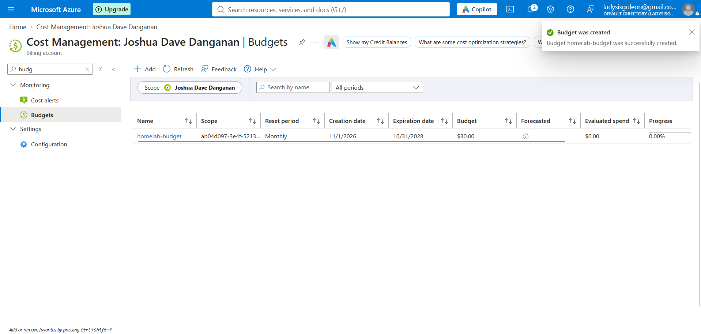
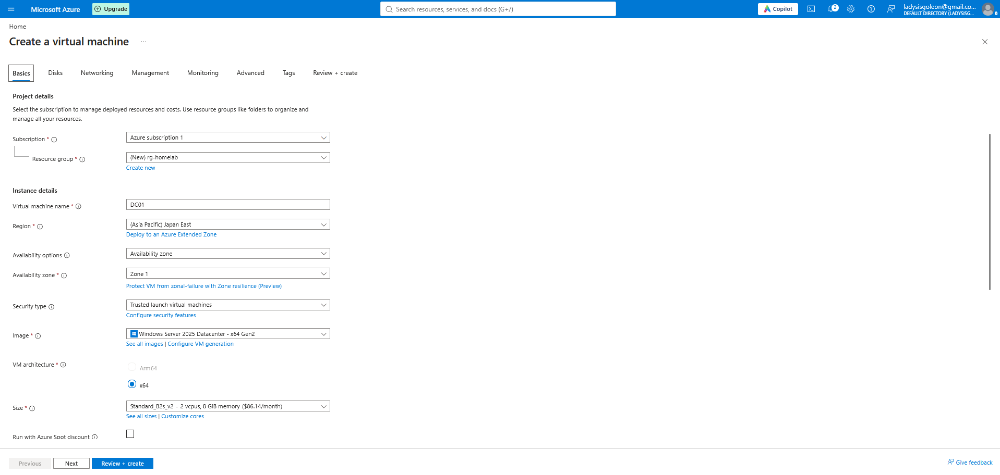
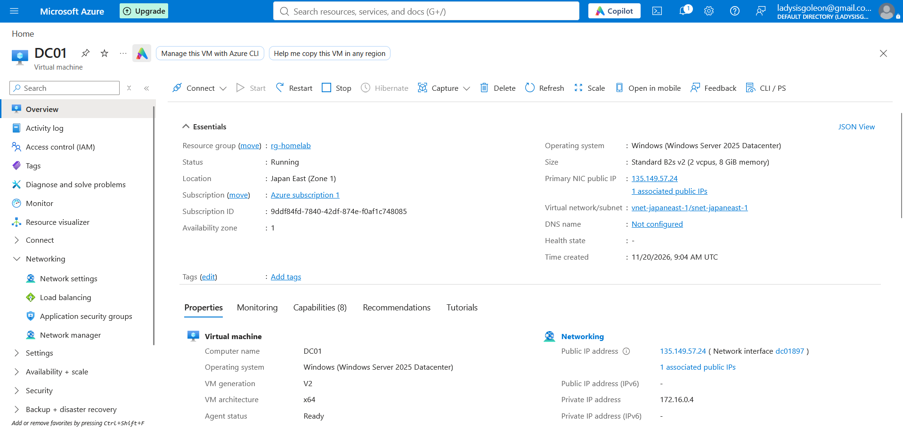
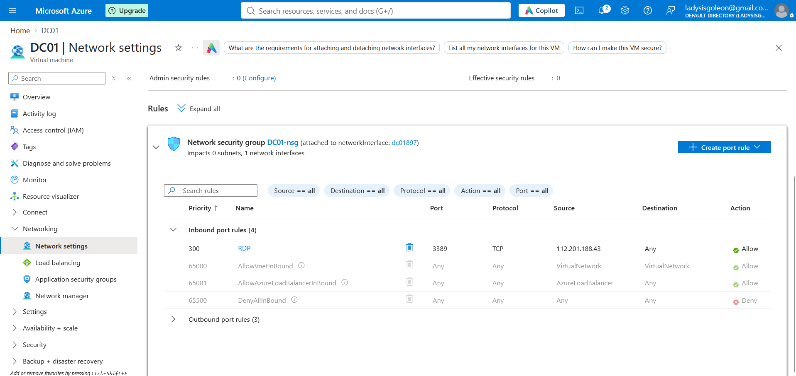
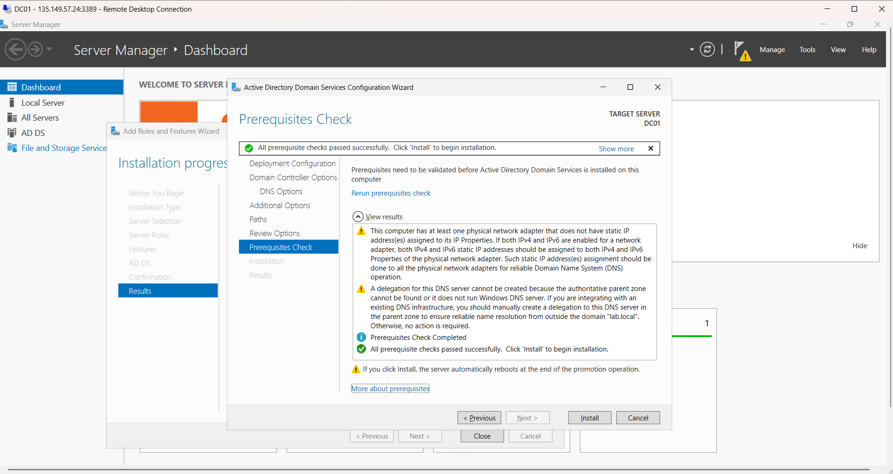
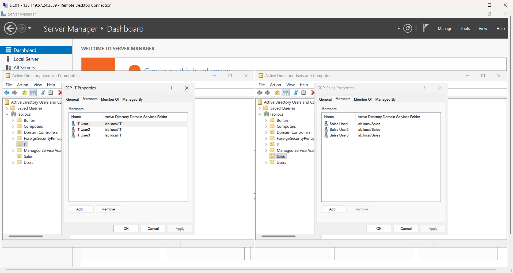

# Azure Windows Server and Active Directory Lab

## Overview

I deployed a Windows Server 2025 virtual machine on Microsoft Azure to build a small company domain environment. I set up Active Directory, departments (OUs), user accounts, security groups, and a Group Policy to practice Windows Server administration and user management.

## Tools Used

- Microsoft Azure
- Windows Server 2025 Datacenter
- Active Directory Domain Services (AD DS)
- Group Policy Management
- Remote Desktop Protocol (RDP)
- Azure Network Security Groups (NSGs)
- Azure Cost Management

## Lab Environment

| Component | Configuration |
|---|---|
| Cloud Platform | Microsoft Azure |
| Virtual Machine | DC01 |
| Operating System | Windows Server 2025 Datacenter |
| VM Size | Standard B2s |
| Resource Group | rg-homelab |
| Domain | lab.local |
| Departments | Sales and IT |
| User Accounts | 6 test users |
| Security Groups | GRP-Sales and GRP-IT |

## Steps

### 1. Budget Alert

Created a budget alert in Azure Cost Management to track spending and turned on auto-shutdown for the VM to avoid unnecessary charges.

### 2. VM Deployment

Created a Windows Server 2025 Datacenter VM named `DC01` in the `rg-homelab` resource group.

### 3. Restricting Remote Access

Limited RDP (TCP port 3389) to my own public IP address using a Network Security Group rule.

### 4. Remote Desktop Connection

Connected to the server with RDP and opened Server Manager.

### 5. Active Directory Setup

Installed the AD DS role and promoted `DC01` to a domain controller for the new `lab.local` forest.

### 6. OUs, Users, and Groups

Created two OUs for departments:

- Sales: 3 test users and the `GRP-Sales` group
- IT: 3 test users and the `GRP-IT` group

Added each user to their department's security group.

### 7. Group Policy

Created a Group Policy Object named `Sales-Restrictions` and linked it to the Sales OU. I enabled the "Prohibit access to Control Panel and PC settings" policy under User Configuration.

## Results

- Deployed a Windows Server 2025 domain controller on Azure
- Set up the `lab.local` Active Directory domain
- Organized six test users into two department OUs
- Created security groups and assigned users to them
- Created and linked a Group Policy Object to the Sales OU
- Restricted RDP access to my own IP address

**Testing limitation:** I have not yet confirmed that the Group Policy applies to Sales users. This would need a separate domain-joined Windows client.

## Problems and Fixes

| Issue | Fix |
|---|---|
| VM status looked outdated after starting | Waited for Azure to update and refreshed the portal |
| VM Overview page was blank | Opened the VM from the Virtual Machines list and did a hard refresh |
| VM agent status showed "Not ready" | Waited a few minutes after the restart until it reported normally |

## What I Learned

- Creating and securing a virtual machine on Azure
- Installing and configuring Windows Server roles
- Setting up an Active Directory domain
- Managing OUs, users, and security groups
- Creating and linking Group Policy Objects

## Future Improvements

- Add a domain-joined Windows client to test Group Policy enforcement
- Practice password resets and account lockout troubleshooting

## Status

Core setup completed. Group Policy enforcement testing pending.
