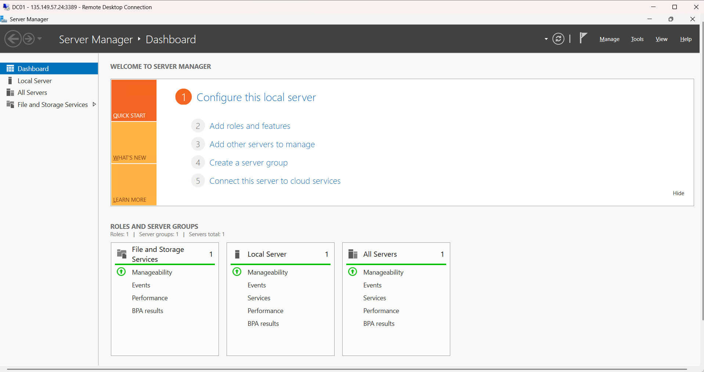
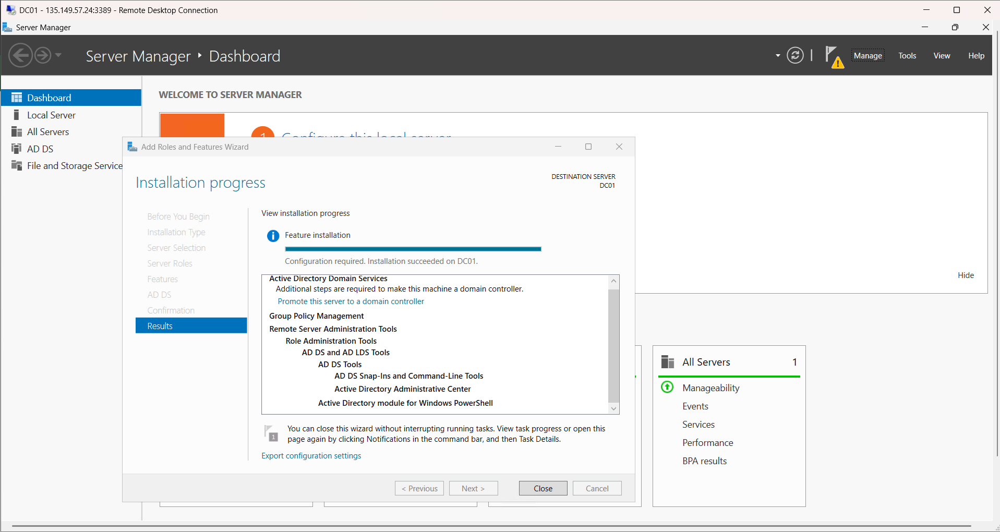
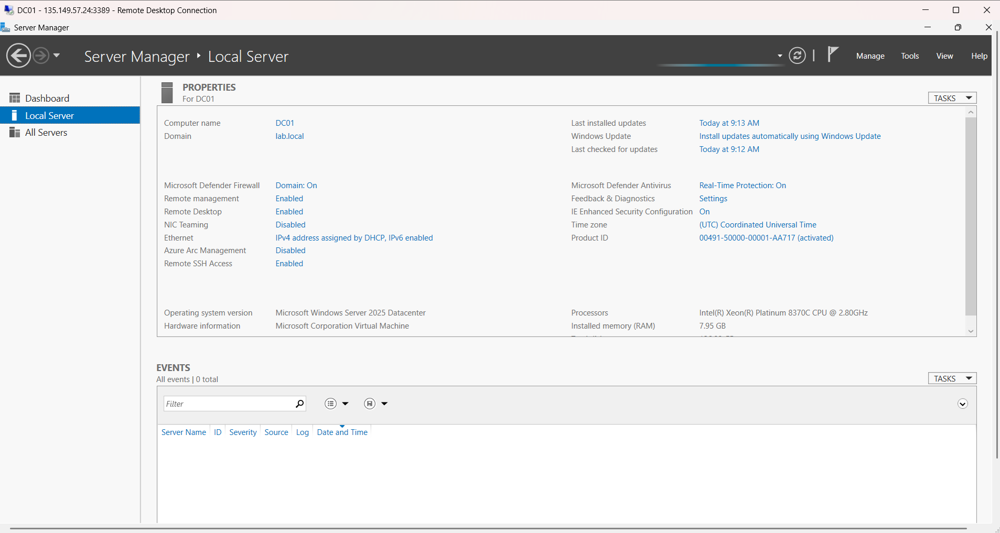
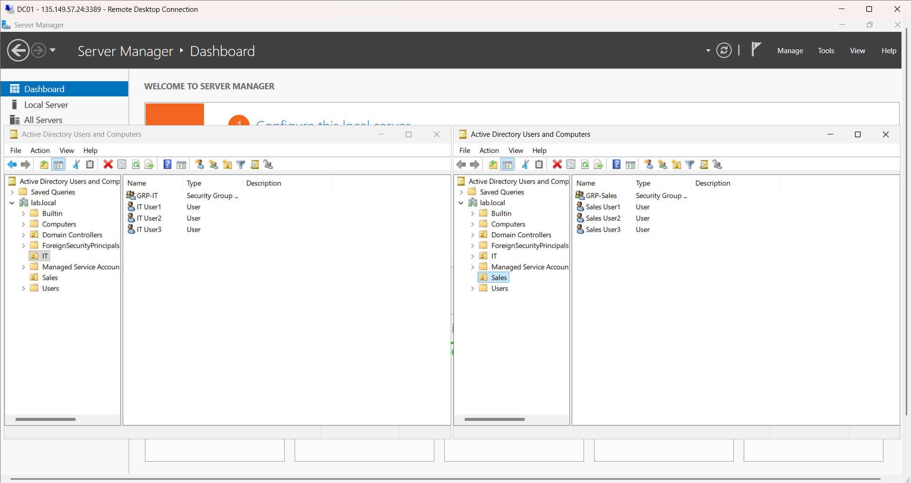
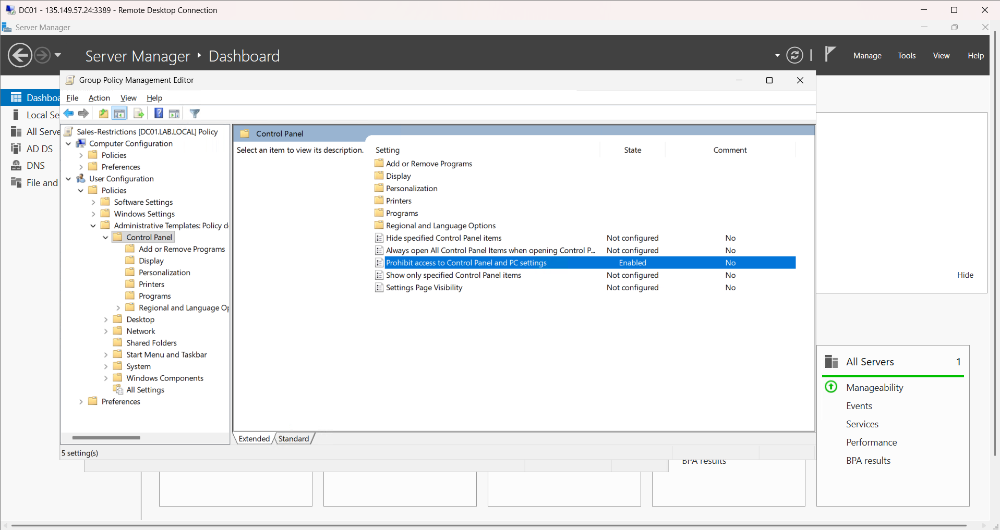
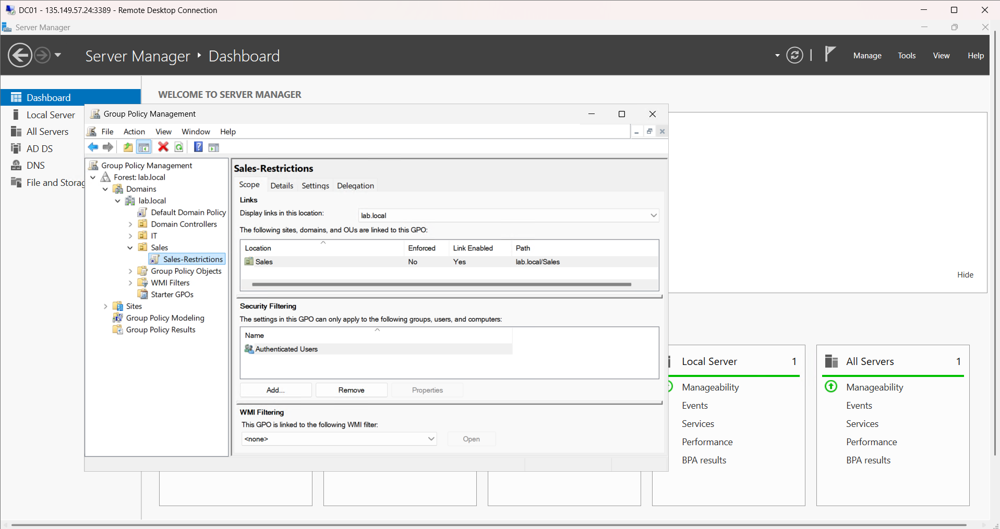

# Azure Windows Server Lab

## Goal
Built a Windows Server domain on Azure with Active Directory, organizational units, users, groups, and a Group Policy.

## Environment
- Platform: Microsoft Azure
- OS: Windows (Windows Server 2025 Datacenter)
- VM size: Standard B2s
- Domain: lab.local

## Steps
1. **Budget alert:** set a spending alert to track credits.
   
2. **Created the VM:** DC01 in resource group rg-homelab.
   
   
3. **Restricted RDP:** limited port 3389 to my IP only.
   
4. **Connected with RDP.**
   
5. **Installed Active Directory and promoted to domain controller.**
   
   
   
6. **Created OUs, users, and groups:** Sales and IT, 3 users each, GRP-Sales and GRP-IT.
   
   
7. **Created a Group Policy:** blocks Control Panel access, linked to the Sales OU.
   
   

## Results
- Domain controller running and reachable over RDP
- 6 users in 2 OUs, assigned to security groups
- Sales-Restrictions GPO linked to the Sales OU with Control Panel access set to Enabled
- Enforcement testing: pending (would require a domain-joined client VM)

## Problems and fixes
- VM looked stopped after starting: waited for the status to update and refreshed the portal.
- Overview page was blank: used the Virtual machines list and hard refresh.
- "Agent status not ready" warning: normal after a restart, cleared after a few minutes.

## What I learned
- How to deploy and secure a Windows Server VM on Azure
- How to set up Active Directory, OUs, users, and groups
- How Group Policy links to an OU
- How to track Azure costs and clean up resources
